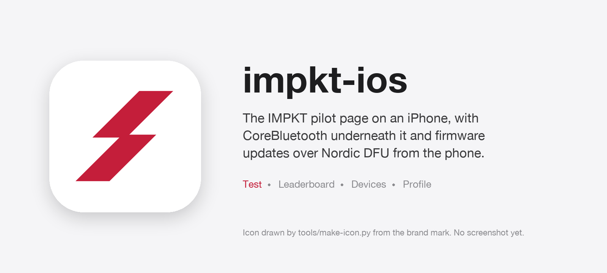
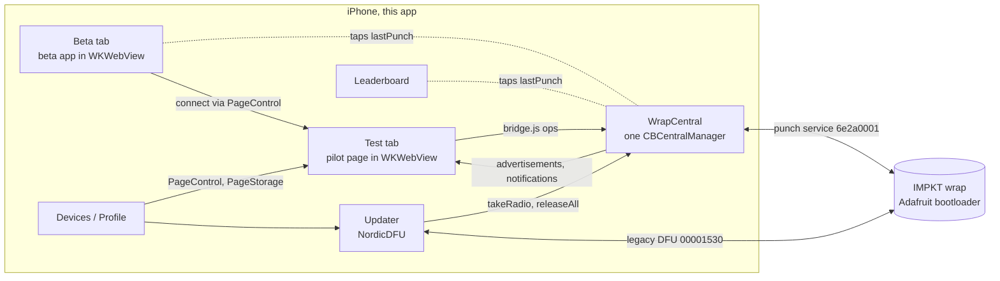

# impkt-ios

iOS app for the IMPKT boxing wearable: the pilot web page on CoreBluetooth, a gym leaderboard, and firmware updates over Nordic DFU from the phone.


<!-- TODO(owner): add App Store/simulator screenshot. The image above is composed from the app icon by tools/make-hero.py; there is no screenshot in the repository yet. -->

## What it does

IMPKT wraps are a pair of Bluetooth LE boxing hand wraps, one per hand, on
Nordic-based boards running the Adafruit bootloader. Their pilot page,
`impktband.com/test`, is an ordinary web page that talks to the wraps through
Web Bluetooth. iOS has no Web Bluetooth, so this app is that page inside a
`WKWebView` with a real radio supplied underneath it, plus the three jobs a web
page cannot do on a phone, and a Beta tab for the next app. Five tabs:

| Tab | What it does | Source |
| --- | --- | --- |
| **Test** | The pilot page, unmodified, served from the bundle over the app's own `impkt://` URL scheme so relative paths and `fetch` work as they do on the site. `bridge.js` is injected at document start and implements the part of `navigator.bluetooth` the page uses (`getDevices`, `requestDevice`, `requestLEScan`, `watchAdvertisements`, `connect`, `getPrimaryService`, `getCharacteristic`, `startNotifications`, `readValue`, `writeValue`) by messaging the Swift side. | `PilotPage.swift`, `Resources/bridge.js` |
| **Beta** | The next IMPKT app (Train, Session, History, Settings), built in Lovable and bundled as a single-page app at `impkt://beta/`. It gets no Bluetooth of its own: like the Leaderboard it is handed every punch off the Test tab's link, and its Connect asks the page to connect the wraps, the way Devices does. Each punch arrives with the firmware's power score, peak g, hand speed and which hand threw it. Sessions are kept in its own `localStorage`. Source in `beta/`. | `BetaPage.swift`, `beta/src/lib/band.ts` |
| **Leaderboard** | One band passed down a queue of people in a gym: a name is typed, the best punch of the turn goes on the board, with the left/right split and the hand speed of the best punch. Reads punches off the notifications the page is already receiving, so it never competes for the radio. Standings persist across launches and can be shared as plain text. | `Leaderboard.swift`, `LeaderboardView.swift` |
| **Devices** | Connect or disconnect each hand (by asking the page, which owns the links), a Nearby list sorted by signal strength, the wraps this phone remembers, and firmware updates. A connection log of every Bluetooth step and its answer can be copied off the screen. | `DevicesView.swift`, `PageControl.swift`, `ConnectionLog.swift` |
| **Profile** | What the page has stored (name, code, measurements, which wrap is on which hand, drills waiting to upload), read from the page's own `localStorage` through the web view rather than kept twice, and the privacy policy. | `ProfileView.swift`, `PageStorage.swift`, `PrivacyPolicyView.swift` |



**One CoreBluetooth central for the whole app** (`WrapCentral.swift`). Wraps are
recognised by the punch service UUID in their advertisement, never by name,
because boards are being named by hand. The scan also asks for the Nordic DFU
service, so a wrap left in its bootloader by an interrupted update is still
visible to the one screen that can rescue it. Every connect carries its own 12 s
deadline, because CoreBluetooth has none; rows age out 15 s after the last
advertisement; a connected wrap's signal strength is re-read off the link every
2 s, since a connected wrap stops advertising. Which hand a wrap is on comes
from the wrap's own identity characteristic, learned by watching the page read
it, not from the advertised name.

**Punch records** (`Punch.swift`). The firmware's 20-byte little-endian
`punch_packet_t` is decoded for the leaderboard: power score, peak linear g, raw
g, hand speed, rotation rate, extension window, railed sample count, rebuilt
peak and flags. Punches flagged as replays (thrown while the link was down) are
dropped rather than credited to whoever is at the bag now. For boards older than
firmware v2.21, where a punch that hit the accelerometer's 16 g rail was scored
from a pinned peak, the peak is reconstructed from the time on the rail and the
hand speed so that one gym running old and new boards has one scale.

**Firmware updates** (`UpdateView.swift`, `FirmwareVersion.swift`). The app
ships firmware **v2.25** with **v2.24** as the way back, both as DFU packages in
`IMPKT/Resources`, and drives Nordic's `IOS-DFU-Library` through the legacy DFU
protocol the Adafruit bootloader speaks. Before an update starts, every link the
app holds is dropped and the radio is handed to the updater, because a wrap
accepts one connection and stops advertising while it has one. The bootloader is
picked by its advertised name rather than by the DFU service UUID, which the
running firmware also advertises. The button beside each wrap is labelled from
what that wrap has reported: *Update to 2.25*, *Reinstall 2.25* when it is
already there, or *Install 2.25* when it has not said. A failed update shows the
library's own log and offers *Finish update* against a bootloader that is
actually on the air, or *Install 2.24 instead*. Because the image is bundled, a
firmware release is an app release, and "what firmware is on my wraps" has one
answer.

## Why I built it

iOS has no Web Bluetooth and Apple has never shipped it, so the pilot page could
not talk to a wrap in Safari. Everything else about the page worked there. So
the page is kept whole and only its radio is replaced: `bridge.js` installs a
`navigator.bluetooth` that forwards to CoreBluetooth, and the page cannot tell
the difference. One page, one set of wording, one place a change lands, and the
same file keeps serving the website.

The second reason is updating firmware without a laptop. The wraps speak Nordic's
legacy DFU protocol, Nordic ship the iOS implementation, and a phone in the same
room can therefore do what previously needed a Mac, a cable and the firmware
repository. Send somebody the app through TestFlight and they can update wraps
on another continent, in their own room, with the firmware that came inside the
app.

The Leaderboard tab came from handing a band to a gym: within a minute the
question is "who hit hardest", which is a different shape from a guided drill
and worth a screen of its own.

## How to build and run it

1. Install Xcode from the App Store.
2. `./sync-web.sh` copies the pilot page, its stylesheet, fonts and pilot list
   out of the website checkout, and the newest `BOXING-01_v*_dfu_package.zip`
   (plus the release before it) out of the firmware build folder. Paths are
   overridable with `PAGE=` and `FW_DIR=`. The copies are committed, so a fresh
   clone builds without either.
3. `./sync-beta.sh` builds the Beta tab's app out of `beta/` (`npm run build:app`)
   into `IMPKT/Resources/Beta`. Also committed; run it after changing anything in
   `beta/`.
4. `brew install xcodegen && xcodegen generate`, then open `IMPKT.xcodeproj`.
   `project.yml` is the project: iOS 16 deployment target, the `NordicDFU`
   package from 4.15.0, and `Web/`, `css/`, `fonts/` added as folder references
   so the page's relative paths survive into the bundle.
5. Pick your team under Signing & Capabilities.
6. Run it on a real iPhone. The simulator has no Bluetooth radio and will find
   nothing, which looks like a bug and is not one.

### Tests

```bash
./tools/test-app-logic.sh        # swiftc only, no Xcode: version rules, punch decoder, connection log
node tools/test-page-hands.js    # the page's hand-matching, lifted out of index.html and run in Node
```

`FirmwareVersion.swift`, `Punch.swift` and `ConnectionLog.swift` are Foundation
only on purpose, so `Tests/AppLogicTests.swift` compiles against them with the
Swift compiler alone.

### Continuous integration

`.github/workflows/testflight.yml` runs on every push to `main` on a macOS
runner: pick the newest Xcode on the image, generate the project, check the
bundled page and firmware are present, run both test scripts, and compile for
the simulator with signing off. If the four App Store Connect secrets are set it
goes on to sweep dead runner certificates off the account (`tools/asc.py
sweep-certs`), archive with automatic signing, verify the page's files survived
into the built bundle, export, and upload to TestFlight, using the run number as
the build number. `tools/asc.py` talks to the App Store Connect API with an
ES256 token signed by `openssl`, so nothing has to be installed on the machine
that uses it.

### Other tools

- `tools/preview.py` serves `IMPKT/Resources` the way the app's scheme handler
  does, in a phone-sized frame in the browser, reloading on save. Only the Test
  tab is real; `preview-tabs.js/.css` are hand-drawn HTML mirrors of the SwiftUI
  tabs.
- `tools/wrap-connect-test.py` walks a plugged-in wrap through the same steps the
  app takes, from a Mac with `bleak`, to separate a firmware fault from a phone fault.
- `tools/webkit-probe.swift` loads a page in a real `WKWebView` at phone size and
  reports its layout.
- `tools/make-icon.py` rasterises the brand mark into the 1024 px icon with no
  image library; `tools/make-hero.py` composes the README image from it.

## Results

- Both test scripts pass locally on this machine (Swift 6.4 toolchain, Node 24):
  `tools/test-app-logic.sh` 39 checks, `tools/test-page-hands.js` 14 checks, no
  failures. The full Xcode build was not run here; the workflow does that on a
  macOS runner.
- The app bundles firmware v2.25 with v2.24 as the fallback
  (`IMPKT/Resources/firmware-version.txt`, `firmware-previous-version.txt`), and
  the test suite checks that the fallback is older than the bundled release.
- Firmware releases shipped through the app so far, from the commit history:
  v2.9, v2.10, v2.14, v2.15, v2.16, v2.24 and v2.25.
- The TestFlight pipeline has run often enough to hit Apple's cap of ten
  development certificates per team, which is why the certificate sweep exists.
- Nothing here measures radio range or throughput; the constants in
  `WrapCentral` (12 s connect deadline, 15 s staleness, 2 s RSSI poll, 25 s DFU
  connection timeout) are design choices written down in the code, not
  measurements.

## What I learned

Most of these are written at the place in the code where they bit.

- **CoreBluetooth `connect` has no timeout.** It is a standing request that
  completes whenever the peripheral reappears, so every connect gets its own
  deadline, and on timeout the pending request is cancelled too, or the app
  connects to a wrap nobody asked for minutes later.
- **A wrap accepts one connection and stops advertising while it has one.**
  Releasing only the update target released nothing when the bootloader was a
  different identifier; the page's link to the application stayed up and the DFU
  library waited out its timeout against a board a foot away. Every link is
  dropped first, and dropped means the disconnect has landed, not been asked for.
- **The Adafruit bootloader keeps the board's address when the app asked for the
  jump**, because peer data is handed over before the reset, so it comes back as
  the same iOS peripheral calling itself `AdaDFU`. Forgetting a "bootloader"
  identifier therefore forgot the real wrap, permanently.
- **A split advertisement looks like a bootloader.** The firmware's name and DFU
  UUID live in the scan response, and iOS may deliver the scan response alone:
  DFU present, punch service absent. One such callback used to flip a healthy
  wrap into "update mode" for good. The punch service is now remembered per
  peripheral and the name is the deciding test.
- **iOS caches a GATT table per address.** After a failed update it can answer a
  connect to the running firmware with the bootloader's table. Asking for the
  punch service by UUID, once, is the only thing the app can do about it.
- **In legacy DFU, `alternativeAdvertisingNameEnabled` is ignored**, and the
  library's default peripheral selector takes the first thing advertising the
  DFU UUID, which in a room with two wraps is the other wrap. A selector on the
  advertised name fixes both.
- **`file://` is not an origin a page can live on.** `WKWebView` refuses `fetch`
  there and `localStorage` is unreliable, so the bundle is served over a custom
  scheme by a rooted, path-checked handler. Everything evaluated into the page
  goes through JSON serialisation, because an advertised name is remote input.
- **The silent switch mutes a drill.** The default audio session category obeys
  it; `.playback` with `.mixWithOthers` keeps the cues and leaves the boxer's
  music alone.
- **A fresh macOS runner mints a new development certificate every build**, and
  Apple caps a team at ten. `altool` also exits 0 after printing `UPLOAD FAILED`,
  so the workflow greps the output instead of trusting the exit code.
- **Keep testable logic Foundation-only.** The version rules, the packet decoder
  and the log compile with `swiftc` alone, which made tests possible on a machine
  without Xcode and keeps them fast in CI.

## What I would do next

My notes at the time of writing, not a committed roadmap.

- Replace the `swiftc` test script with an XCTest target now that CI has Xcode;
  the script exists because the development machine did not.
- A mock `WrapCentral` so the native tabs can be exercised in the simulator,
  which has no radio.
- Retire the pre-v2.21 railed-peak reconstruction in `Punch.peak` once every wrap
  is on v2.21 or later; the code keeps it for boards still on 2.16 and 2.20.
- The HTML mirrors in `tools/preview-tabs.js` have to be updated by hand when a
  Swift view changes. Either generate them or replace them with simulator
  screenshots, which would also give this README a real hero image.

## Licence and credits

MIT, see [LICENSE](LICENSE).

- [NordicSemiconductor/IOS-DFU-Library](https://github.com/NordicSemiconductor/IOS-DFU-Library)
  (BSD-3-Clause) is fetched by Swift Package Manager from `project.yml`, not
  vendored; it is the DFU implementation the update screen drives.
- [IBM Plex Sans](https://github.com/IBM/plex) (SIL Open Font License 1.1) is
  bundled as two `.woff2` files in `IMPKT/Resources/fonts` for the page.
- `IMPKT/Resources/Web/index.html`, `css/pilot.css` and `pilots.json` are copies
  of the pilot website, which is my own work in a separate repository; they are
  marked `linguist-vendored` here so GitHub counts this repository as Swift.
- The DFU packages in `IMPKT/Resources` are builds of the wraps' firmware from
  its own repository. <!-- TODO(owner): link the public firmware repository -->
- The wraps run the Adafruit nRF52 bootloader, which is on the boards, not in
  this repository.
